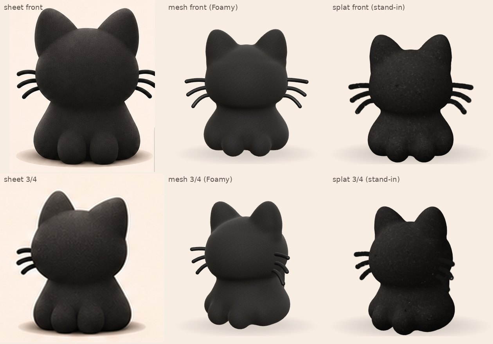
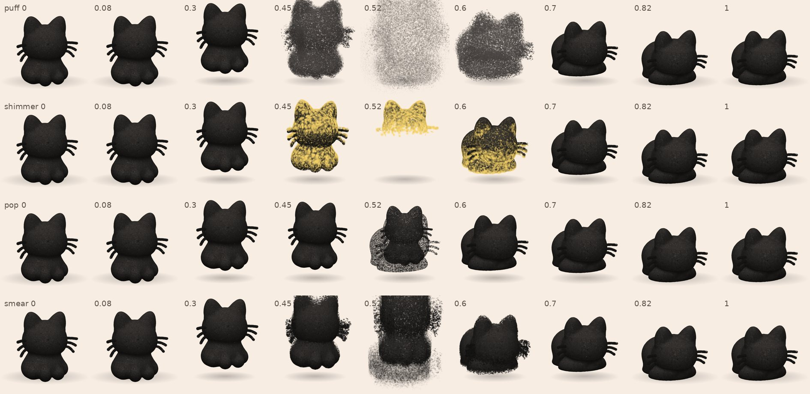
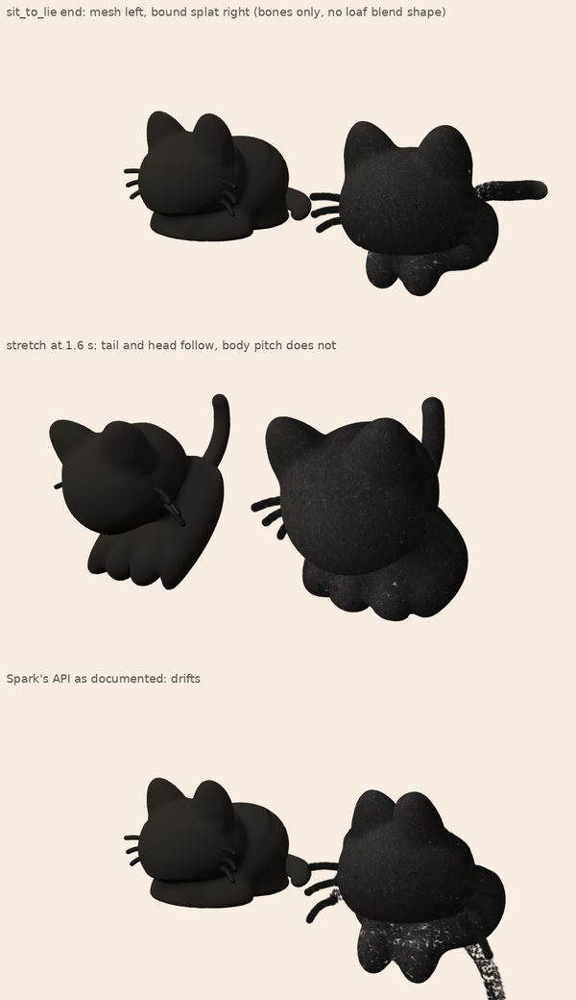

# Gaussian splats and Idol for Sigil Cat
Can Gaussian splats (and Idol, one image to a splat) give the cat its felt look, a way to move, and other gags?
Exploration, 2026-11-08 (sub-session sigil-cat-splats). Prototype: `prototypes/splats/`. The live site is untouched.

## Status
- **Done:** renderer pick (Spark), the pop-pose prototype with four transition styles and an idle bob, a skinning
  test (partly working, see 2), file sizes measured on real Idol output, phone budget from published numbers.
- **Waiting on DINOv3 access:** every Idol splat of *our* cat. The demo Space's anonymous GPU quota ran out on the
  first try (it asks for 180 s per run and the "timed out" first calls had used the quota). Aaron logged in to
  Hugging Face: FLUX.2-dev opens, Meta's `facebook/dinov3-vith16plus-pretrain-lvd1689m` is still pending approval.
  Until then the prototype runs on **stand-in splats** baked in the browser from the mesh cat's own poses, so
  question 1 (look) is only half answered.
- **Local Idol install** (outside the repo, not committed): `~/ai/idol-sdk` (github.com/speridlabs/idol-sdk @ 4702a7f),
  venv `~/ai/idol-venv` (torch cu128 for the RTX 5070 Ti), installer `~/ai/splat-work/scripts/install_idol.sh`,
  log `~/ai/splat-work/install.log` (ends `INSTALL-DONE` when torch, the SDK, Idol's weights and the FLUX.2 VAE
  folder are in). Inputs already staged in `~/ai/splat-work/idol-in/`: `sit-front.png` (views/main.png),
  `sit-tq.png` (views/three-quarter-front.png), `loaf.png`, `sleep.png`, `stretch.png` (poses/*-hero.png).

### Run Idol once DINOv3 opens
```bash
tail -1 ~/ai/splat-work/install.log          # INSTALL-DONE? if not: bash ~/ai/splat-work/scripts/install_idol.sh
cd ~/ai/splat-work && ~/ai/idol-venv/bin/python -I -m idol.sample \
  --image idol-in --out idol-local --mode synthetic --num_gaussians 262144 --seed 42
```
About 20 s per image on the 5070 Ti, 7.2 GB VRAM peak (Idol README); check `free -g` first, other GPU jobs may have priority.
Then, per pose: line the splat up with the mesh pose (scale, turn, move: `splat-transform -s/-r/-t`, values read
off its bounding box against the mesh's), thin it to 65k and write SPZ into the prototype:
```bash
ST=~/ai/splat-work/tools/node_modules/.bin/splat-transform
$ST -w idol-local/loaf.ply -s <scale> -r <x,y,z> -t <x,y,z> -d 65536 <worktree>/prototypes/splats/splats/loaf.spz
```
and open `prototypes/splats/#src=idol` (files `splats/sit.spz`, `loaf.spz`, `sleep.spz`, `stretch.spz`;
`skin.html#src=idol` uses `sit.spz`). Then finish question 1 with the same side-by-side shots as below.

## 1. Look: does a splat catch the flocked fuzz better than the mesh?
**Verdict: not settled; leaning yes for the outline, unknown for the surface until Idol runs.**
- What a splat gives for free: a soft, slightly furry silhouette (no hard polygon edge, no fuzz shells needed) and
  no shimmer when turning, because its colour is baked and there is no per-pixel noise to alias. Both were the
  mesh shader's problems (`docs/ideas/cat-look.md`, "Texture").
- What it costs: the light is baked in. A splat cat looks lit from wherever the source image was lit, whichever way
  it turns. On a bone-beige page with one soft studio light that is fine; any lighting gag (dusk, a flashlight) is out.
- Stand-in result (`look-compare.jpg`): sheet, mesh (current "Foamy" look) and stand-in splat, front and 3/4.
  The stand-in's felt is the fibre tile baked into flat discs plus a layer of short lifted strands (two bent
  Gaussians each). Side by side: the stand-in is grainier and darker than the sheet, with a slightly ragged rim where
  the mesh is smooth; the mesh's Foamy look is closer to the sheet's soft, even felt. The strands read as specks at
  65k, not as the sheet's curly fibres. So a splat *baked from our mesh* does not beat the mesh shader. An Idol splat
  copies the sheet's own fibres and light from the image, which is the open question once DINOv3 opens.


## 2. Motion
### The pop approach (Aaron's direction, the main prototype)
Four still splats (sit, loaf, sleep, stretch) and a pose change that pops instead of morphing.
`prototypes/splats/index.html`: buttons for pose, transition style and Gaussian count; tap the cat for the next pose;
`#auto=0`, `#style=`, `#n=`, `#yaw=`, `?perf=1`; `#from=sit&to=loaf&u=0.5` freezes a moment.
- **Timing** (one change = 2 beats at Butterman's 80 bpm = 1.5 s, rubber-hose shape): anticipation squash (0–12%),
  float up with overshoot (10–40%) and a little shake (22–50%), the swap (38–70%), drop (62–78%), landing squash that
  springs back (78–100%). Idle: a float bob of 1.8% of his height every 2 beats with a breath of squash.
- **Styles** (one GPU modifier per pose, Spark `dyno`; phase 0 = here, 1 = gone; the incoming pose runs it backwards):
  - **puff**: every Gaussian flies outward from the centre with a random spread, grows and greys into smoke, fades;
    the next pose condenses out of its own cloud.
  - **shimmer**: a butter-gold sparkle edge sweeps through by height plus random, Gaussians behind it vanish.
  - **pop**: each Gaussian shrinks to nothing with a small random stagger while the whole pose shrinks; the next
    springs in to 118% and wobbles back to 100%.
  - **smear**: Gaussians streak up (out) and down (in) with a per-Gaussian lag, like a cartoon smear frame.

- Contact sheets use the stand-in splats (sit to loaf, 3/4 view). With Idol splats the code is unchanged.
- Read of the sheets: **shimmer** and **pop** land cleanly. **Smear** reads, but its streaks fill the frame at the
  swap. **Puff** is too big: at the swap both poses' clouds overlap into a grey cloud wider than the cat (already
  toned down once); next step is a smaller spread, fewer Gaussians in the cloud, or puffing only the outgoing pose.
  Judge the timing live; stills can't show the springs.

### Skinning (can a splat follow our rig?)
**Verdict: not yet. Partly follows the skeleton; can't follow the pose shapes; the pop approach makes it moot.**
`prototypes/splats/skin.html` binds the splat to the
GLB's 40 bones with nearest-vertex weights (each Gaussian blends the skin weights of its 4 nearest posed vertices,
inverse-distance, top 4 bones) and drives Spark's `SplatSkinning` from the mesh's bones each frame, mesh beside it.
- Spark's skinning API as documented drifts: its dual-quaternion mode builds the bone change as
  `rest⁻¹ × now` with `now − rest` for the move, which turns parts about the world origin, not the bone, so the body
  sinks through the floor (`#naive=1` shows it). Fix used: keep Spark's rest at identity and pass the standard skin
  transform (`now × rest⁻¹`, decomposed) ourselves. With the fix nothing drifts and the tail and head follow, but
  in the stretch the splat's body hardly pitches forward while the mesh's does: still a bug in the binding or the
  bone hand-over, not chased further (Aaron paused this thread). Spark's linear-blend mode needs ext/cov splats and
  draws nothing for a splat built in code.
- The loaf and sleep poses get much of their shape from blend shapes (`cat_body` morph targets `loaf`, `sleep`),
  which bones can't carry. A splat would need a custom modifier adding each Gaussian's nearest-vertex morph delta.
- Expected artefacts with an Idol splat (survey): stretching where Gaussians span a joint, tearing where the single
  image fused paws to the belly, fuzz bound to the wrong bone. The pop approach avoids all of it.


## 3. Web and iPhone
**Verdict: Spark 2.4.0 on our existing WebGLRenderer, SPZ at 65k per pose.**
- **Renderer:** Spark (`@sparkjsdev/spark` 2.4.0, MIT, 2026-10-20; sparkjs.dev). One ES module that imports only
  `three` and `three/addons/postprocessing/Pass.js`, so it drops into our importmap; the prototype runs it with
  three 0.186.1 unchanged:
  `"@sparkjsdev/spark": "https://cdn.jsdelivr.net/npm/@sparkjsdev/spark@2.4.0/dist/spark.module.min.js"`.
  2.85 MB raw, about 713 KB brotli. Splats depth-test against ordinary meshes (shadow, butter, Butterman).
  Sorting: the GPU reads back distances, a worker bucket-sorts, the order can lag a frame.
- **Not these:** three's own `GaussianSplat` (r186) and Spark Radix need WebGPURenderer and have no skinning;
  GaussianSplats3D is unmaintained (its README points to Spark), needs SharedArrayBuffer headers GitHub Pages can't
  set, and crashed iPhone 15 Pro Max Safari at 1M splats; gsplat.js and PlayCanvas are other engines.
- **File size, measured** (Idol's own 262k output, the Space's default example, thinned with `splat-transform -d`).
  Idol writes base colour only (no view-dependent colour), 68 bytes a Gaussian:

  | Gaussians | Idol .ply | compressed .ply | .spz | .sog |
  |---|---|---|---|---|
  | 32,768 | 2.23 MB | 0.53 MB | 0.44 MB | 0.42 MB |
  | 65,536 | 4.46 MB | 1.07 MB | 0.85 MB | 0.81 MB |
  | 131,072 | 8.91 MB | 2.13 MB | 1.66 MB | 1.59 MB |
  | 262,144 | 17.83 MB | 4.27 MB | 3.26 MB | 3.10 MB |

  Four poses at 65k as SPZ: about 3.4 MB plus Spark's 0.7 MB. (.splat is 32 B/Gaussian, .ksplat 24–44.)
- **iPhone, published:** Spark's docs budget 1–3 million splats on iPhone; PlayCanvas measured an iPhone 13 Pro Max
  at 38 fps with 1M splats on WebGL2; Gaussian-VRM (skinned splats in three.js) reports 40–50 fps on iPhone 13 Pro.
  Our 65k–131k (two poses drawn during a pop) is 8–30× under those. Cost will be overdraw (screen coverage × pixel
  ratio), not sorting; keep the pixel ratio capped at 2 and `antialias: false`.
- **Measured here:** none on a phone yet. `?perf=1` in the prototype shows fps, frame time, Gaussians drawn and the
  GPU, readable off an iPhone screenshot, once it is pushed somewhere a phone can open. Headless numbers here are
  software rendering and mean nothing.

## 4. Other uses that fit the vision (ranked)
1. **The pop-pose cat itself** as a mode or easter egg ("the cat glitches into a real object"): the prototype above.
2. **A splat butter pat** for the butter gag: one Idol run on a butter photo or render, 32k Gaussians (~0.4 MB),
   static, so none of the motion problems. It can puff/shimmer in with the same modifiers.
3. **Butterman as a splat cameo**: Idol on `docs/reference/butterman-sheet.png`'s front view, popping between a few
   stills on the beat, the same trick as the cat. Static stills only.
4. **A "real-world relic" in the footer**: a phone-scanned real object (a felt toy, a stick of butter) as .spz from a
   free scanning app, sitting in a little web-1.0 frame: "under construction" for the 2020s.
5. **A splat world behind the hole in the universe**: Spark draws millions of splats and can build them in code
   (`generators`), so a nebula of soft Gaussians would suit it, but sigil-cat-galaxy already built a deep moving
   universe; only worth it if that one falls short.

## Recommendation
Keep the mesh cat on the site. Build the splat cat as the pop-pose mode once DINOv3 access opens: run Idol on the five
staged images, pick sit-front or sit-tq for the sit, line each up with the mesh poses, ship SPZ at 65k (about 3.4 MB
for four poses plus 0.7 MB Spark), judge the look side by side with the sheet, then test `?perf=1` on Aaron's iPhone.
Cost: about one session. Skip skinning the splat; if a pose must move, the pop does it.

### Questions for Aaron
1. Which pop style should lead? Recommendation: **pop** for pose changes (cleanest, most rubber-hose), **shimmer**
   as the butter-themed alternative, **puff** reworked smaller for a special moment. Judge in the prototype.
2. Is baked-in lighting acceptable for the splat cat (it can't be relit)? Recommendation: yes, the page has one
   light anyway.

## Sources
- Idol: speridlabs.com/research/idol · github.com/speridlabs/idol-sdk (Apache-2.0) · huggingface.co/speridlabs/idol
  · demo huggingface.co/spaces/speridlabs/idol (ZeroGPU, `spaces.GPU(duration=120)`).
- Spark: sparkjs.dev/docs (performance, system design, splat-mesh, dyno) · github.com/sparkjsdev/spark
  (`src/SplatSkinning.ts`, examples `splat-dissolve-effects`, `splat-transitions`).
- three.js native splats: github.com/mrdoob/three.js/pull/33950 (r186, WebGPU only).
- GaussianSplats3D: github.com/mkkellogg/GaussianSplats3D (README: no longer developed).
- Formats: github.com/nianticlabs/spz · developer.playcanvas.com/user-manual/gaussian-splatting/formats/ ·
  `@playcanvas/splat-transform` 3.10.3 (used for the size table).
- Phone numbers: sparkjs.dev/docs/performance · blog.playcanvas.com/new-in-supersplat-webgpu-and-streaming-bring-huge-performance-wins
  · arxiv.org/abs/2602.03207 (WebSplatter) · arxiv.org/abs/2510.13978 (Gaussian-VRM).
- Skinned splats: GaussianAvatars arxiv.org/abs/2312.02069 · SplattingAvatar 2403.05087 · 3DGS-Avatar 2312.09228 ·
  GART 2311.16099 · HUGS 2311.17910 · SC-GS 2312.14937 · Mesh-based GS 2402.04796 · G-Skin 2608.01726.

## Splat cat (built 2026-11-08, sub-session sigil-cat-splatcat)
The pop-pose cat is live behind `SITE.cat.mode` (default `'splat'`): `src/splatcat.js`, files `assets/splats/*.spz`,
picks and fallbacks in `docs/REVIEW.md` ("Splat cat"), candidates in `splat-candidates.png`.
- Idol outputs a PLY that Spark shows upside down (y-down): turn it 180 degrees about x. Each output sits in its own
  frame, so the front angle is read off renders per file. splat-transform's frame is turned 180 degrees about x from
  what Spark shows for an `.spz`, so the yaw and the y and z of a move are negated there. `tools/splats/bake.py` does
  all of it, sizes each pose to the mesh's heights (sit 1.0, loaf 0.8, sleep 0.72, stretch 1.08) and prints the
  butter seats.
- First Idol run downloads DINOv3 (3.4 GB) once; after that about 50 s an image on the 5070 Ti.
- The sheet's sit views all fail (flat grey card); a 3/4 render of the mesh sit works.

## Aaron's pick (e1108-31, 2026-11-08)
**Pop** leads for pose changes, with this motion: no rise. The cat floats in the air faintly, bobbing like a buoy;
right before a pose change it shakes slightly, then pops and repositions into the next pose. The future pop-pose mode
(and the prototype, when it's next touched) should match this. Baked-in lighting is fine (e1108-32).
